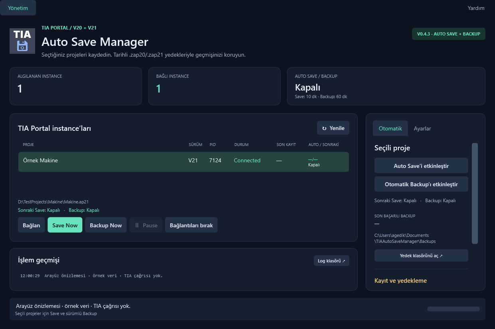

<p align="center"></p>

# TIA Portal Auto Save Manager

Siemens TIA Portal **V20 ve V21** için koyu temalı Windows masaüstü uygulaması. Açık projeleri algılar; manuel/otomatik kayıt, tarihli proje arşivleri ve yedek saklama yönetimi sağlar.

**Güncel sürüm: v0.4.3 · Windows x64 · WPF / .NET 8**



*Önizleme örnek proje verisi kullanır; canlı bir TIA işlemini göstermez.*

## Özellikler

- **Çoklu instance:** V20 ve V21 aynı listede; her sürüm ayrı Openness host sürecini kullanır.
- **Save Now / Auto Save:** Her bağlı proje için ayrı etkinleştirme ve ayarlanabilir kayıt aralığı.
- **Backup Now / Otomatik Backup:** Önce Save, ardından Siemens Archive API'siyle `.zap20` veya `.zap21` oluşturma.
- **Tarihli yedekler:** `ProjeAdı_20261120_0835` biçiminde klasör/dosya adı; aynı dakikadaki ek yedekler `_02`, `_03` ile ayrılır.
- **Doğrulama ve rotation:** Arşiv okuma ve SHA-256 kontrolünden sonra yayımlama; son 5/10/20 yedeği veya sınırsız saklama. Yönetilmeyen dosyalar silinmez.
- **Pause / Resume:** Yeni otomatik işleri duraklatma; başlamış native işlemi zorla kesmeme.
- **Sistem tepsisi:** Arka planda çalışma, kısayola tekrar basınca mevcut pencereye ulaşma, güvenli çıkış.
- **Uyarlanabilir arayüz:** Ekran çalışma alanına/DPI'a sığma, küçük pencerelerde kaydırma ve yeniden yerleşim.
- **Çevrimdışı yardım:** Kullanıcı grubu ayarları, kullanıcı adını bulma ve yedeği geri açma için büyütülebilir ekran görüntüleri.
- **Logging ve ayarlar:** Desktop/host için ayrı dönen günlükler; kalıcı JSON ayarlar.
- **Setup / Update:** Türkçe koyu temalı kurucu; açık Manager'ı kullanıcı onayıyla normal kapatma.

## Destek ve doğrulama durumu

| TIA sürümü | Durum |
|---|---|
| **V20** | Sürüme özel adapter ve `.zap20` desteği eklendi. Gerçek V20 ortamında uçtan uca kabul testi henüz tamamlanmadı. |
| **V21** | Gerçek SDK ile salt okunur keşif testi yapıldı. Bağlanma, manuel Save ve Auto Save kullanıcı ortamında doğrulandı. Backup/Retrieve her hedef ortamda ayrıca kontrol edilmelidir. |
| **V21.1** | Henüz doğrulanmış destek yok; V21 desteği V21.1 uyumluluğu garantisi vermez. |

v0.4.3 paketlemesinde **69 birim testi + 27 WPF testi** geçti. Kurulum kontrol paketi **31 kontrolü**, hem gizli ana pencere hem de ikinci açılış bildirimi senaryosunda çalıştırır. Bunlar gerçek projede kayıt/geri yükleme kabul testinin yerine geçmez.

## Gereksinimler

- TIA Portal sürümünüzün desteklediği **Windows x64** ortamı.
- **TIA Portal V20 veya V21** ve aynı sürümün **Openness** bileşeni.
- **.NET 8 Windows Desktop Runtime x64** ve **.NET Framework 4.8 veya üzeri**.
- TIA'yı çalıştıran Windows hesabının **Siemens TIA Openness** grubunda etkin üyeliği. Üyelik eklendikten sonra Windows oturumunu tamamen kapatıp yeniden açın.
- Bağlanırken TIA Portal'ın uygulama erişim istemine kullanıcı onayı.

Siemens DLL'leri, TIA Portal kurucusu ve lisanslı proje dosyaları bu depoda bulunmaz. Uygulama kullanıcının yerel Siemens kurulumunu kullanır.

## İlk kullanım

1. Ayrı bir test projesini TIA Portal'da açın.
2. Manager'da **Yenile** seçin; doğru proje yolunu, sürümü ve PID'yi kontrol edin.
3. **Bağlan** seçip TIA erişim istemine izin verin. `Detected` algılamayı, `Connected` bağlantıyı gösterir.
4. **Save Now** ile manuel kaydı doğrulayın.
5. **Ayarlar** bölümünde aralıkları, kısa bir yedek kökünü ve saklama sayısını belirleyip kaydedin. Örnek: `C:\TIA_Backups`.
6. **Otomatik** bölümünden seçili proje için Auto Save ve/veya Backup'ı ayrı etkinleştirin. Her açılışta otomatik işlemler kapalı başlar.
7. İlk yedeği kaynak TIA sürümüyle ayrı, kısa ve boş bir klasöre geri açıp içeriğini doğrulayın.

**Save açık projeyi kendi konumuna kaydeder; ayrı bir yedek üretmez.** Save, TIA Portal'ın Undo/Redo geçmişini temizler. Backup da önce Save yaptığı için aynı davranış geçerlidir.

`.zap20` / `.zap21` sıkıştırılmış proje arşividir. İlk açılışta **Select target directory**, arşivin çıkarılacağı klasörü sorar. `Subfolder already exists` uyarısında mevcut projeyi korumak için üzerine yazmayı onaylamayın; yeni ve boş bir hedef seçin.

## Kaynaktan derleme

Derleme bilgisayarında .NET **SDK 8.0.425** (`global.json`), .NET Framework 4.8 targeting pack ve **V21 Openness SDK** bulunmalıdır. V20 adapter'ı çalışma anında gerçek V20 SDK'sına bağlanır; V20-only hedef bilgisayarda V21 kurulumu gerekmez.

```powershell
git clone https://github.com/YucelGedik/TIAAutoSaveManager.git
cd TIAAutoSaveManager
.\scripts\build.ps1 -Publish
```

Komut restore, Release build, birim/WPF testleri ve framework-dependent publish çalıştırır. Çıktı: `artifacts/TIAAutoSaveManager/TIAAutoSaveManager.App.exe`.

**Tüm klasörü birlikte kullanın.** DLL'ler ve `host` alt klasörü gereklidir; host uygulamasını tek başına açmayın. Siemens DLL'leri publish çıktısına dahil edilmez.

Gerçek V21 SDK üzerinden yalnız **Discover** testi eklemek için:

```powershell
.\scripts\build.ps1 -SkipRestore -ReadOnlyV21
```

Bu test Attach, Save veya Archive göndermez. Özel SDK yolu ve diğer ayrıntılar [kullanım ve derleme rehberindedir](docs/KULLANIM.md).

## Setup / Update oluşturma

```powershell
# .NET kurucularını içeren çevrimdışı tam Setup
.\scripts\build-installer.ps1

# Önceden kurulu önkoşulları kullanan küçük güncelleme
.\scripts\build-installer.ps1 -UpdateOnly
```

Betik [sabitlenmiş bağımlılıkları](installer/dependencies.json) resmî kaynaklardan indirir; hash ve yayıncı imzalarını doğrular. Inno Setup derleyicisini çalışma klasöründe taşınabilir modda hazırlar. Build sırasında gerçek ürün kurulumu çalıştırılmaz; kapanış testleri yalnız ayrı test pencerelerini kullanır.

Kurucular `artifacts/setup/` altında oluşur. **Tam Setup** eksik .NET bileşenlerini çevrimdışı kurabilir; **Update** .NET kurucularını içermez. Güncelleme ayarları/yedekleri korur. Kaldırma kullanıcı verilerini veya paylaşılan .NET bileşenlerini silmez.

Bu depo kaynak ve kurulum betiklerini içerir; `.exe` paketleri Git geçmişine eklenmez. Temiz Windows üzerinde kurulum/yeniden başlatma kabul testi ayrıca yapılmalıdır.

## Mimari

```text
App (.NET 8 WPF / MVVM)
 ├─ Core: işlem koordinasyonu, zamanlayıcı, servis sözleşmeleri
 ├─ Infrastructure: ayarlar, yedek doğrulama/rotation, sürüm yönlendirme
 └─ OpennessHost (.NET Framework 4.8 / x64, TIA sürümü başına ayrı süreç)
     ├─ V20: yerel Siemens.Engineering.dll
     └─ V21: yerel Siemens.Engineering.Base.dll
```

Host iletişimi kullanıcıya kısıtlı named pipe ve sınırlandırılmış JSON mesajları kullanır. Siemens tipleri süreç sınırını geçmez. İşlemler seri yürütülür; PID/başlangıç zamanı, sürüm, oturum ve proje yolu yeniden kontrol edilir. Sonucu belirsiz kayıt otomatik tekrar edilmez. `GetProcesses()` ile alınan TIA process nesneleri Dispose edilmez; yalnız host'un kendi bağlantı oturumları bırakılır.

## Belgeler ve sorun bildirimi

- [Ayrıntılı kullanım, kurulum ve sorun giderme](docs/KULLANIM.md)
- [TIAAutoSaver araştırması ve mimari kararı](docs/FAZ-1-ANALIZ.md)
- [Gerçek V21 test planı](docs/V21-TEST-PLANI.md)
- [Üçüncü taraf bildirimleri](docs/THIRD-PARTY-NOTICES.md)
- [Hata bildir / özellik iste](https://github.com/YucelGedik/TIAAutoSaveManager/issues)

Hata bildirirken Manager/TIA sürümünü, Windows ekran ölçeğini, tekrar adımlarını ve ilgili hata metnini ekleyin. Günlük konumu: `%LOCALAPPDATA%\TIAAutoSaveManager\Logs`. Paylaşmadan önce proje yollarını ve diğer özel bilgileri temizleyin.

## Lisans ve bağımsızlık

Projenin kendi kaynak kodu için henüz bir lisans belirlenmedi. Üçüncü taraf bileşenlerin lisansları [bildirimler](docs/THIRD-PARTY-NOTICES.md) ve [licenses](docs/licenses) klasöründedir.

TIAAutoSaver araştırmada incelendi; kaynak kodu veya asset'leri bu uygulamaya kopyalanmadı. Araştırma klonu ve yerel ortam kanıtları yayımlanan depoya dahil değildir. Bu proje bağımsızdır; Siemens'in resmî ürünü değildir. Siemens ve TIA Portal adları ilgili sahiplerine aittir.
